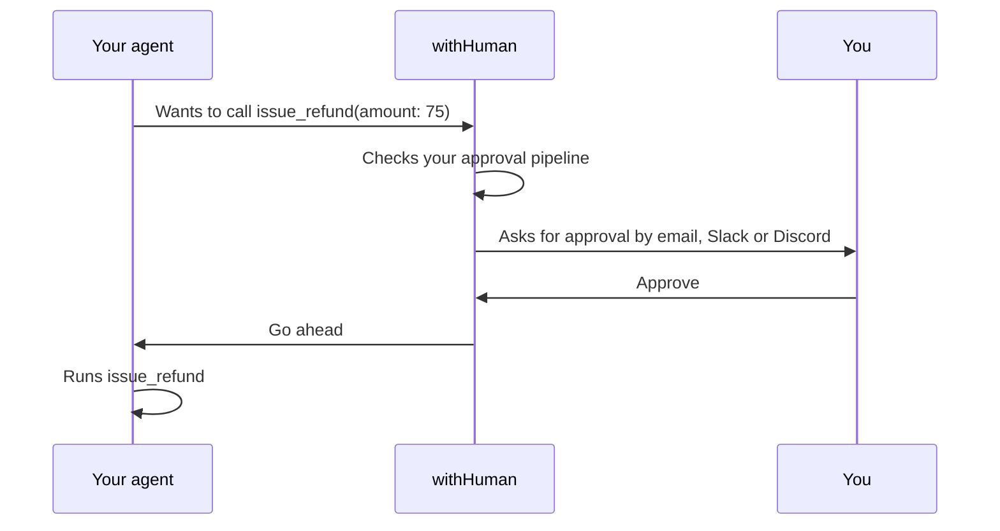

<p align="center">
  
  
</p>

<p align="center"><strong>Approval layer for AI Agents</strong><br>
Put your most consequential agent actions behind human approvals, so your
agents can do real work.</p>

<p align="center">
  <a href="https://github.com/withHumanAI/withHuman/tags"></a>
  <a href="https://github.com/withHumanAI/withHuman/actions/workflows/release.yml"></a>
  <a href="https://quay.io/repository/withhuman/bundle"></a>
  <a href="go.mod"></a>
  <a href="LICENSE"></a>
  <a href="https://agentapprovalprotocol.io"></a>
  <a href="https://discord.gg/fwSryh9p8"></a>
  <a href="https://x.com/withHumanAI"></a>
</p>

<p align="center">
  <a href="https://withhuman.ai">Website</a> ·
  <a href="https://withhuman.ai/docs">Docs</a> ·
  <a href="#quickstart">Quickstart</a> ·
  <a href="https://agentapprovalprotocol.io">Protocol</a> ·
  <a href="https://discord.gg/fwSryh9p8">Discord</a> ·
  <a href="CONTRIBUTING.md">Contributing</a>
</p>

---

We want agents to do more than read data and suggest what to do next. They
should be able to roll back a deployment, issue a refund, or merge code.
Those actions have consequences, and teams need a way to bring a person in
before they happen.

withHuman is the approval layer for that moment. It checks an agent's tool
call before it runs against rules you define in one place. Routine calls
can be approved automatically, disallowed calls can be denied, and
consequential ones can wait for the right person to decide. Every agent you
connect follows those rules.

<p align="center">
  
  
</p>

## How it works

An adapter (a runtime hook or an SDK wrapper) sends each tool call to
withHuman before it runs, over the open
[Agent Approval Protocol](https://agentapprovalprotocol.io).



- **Approval pipelines** approve, deny or ask a person, based on the tool
  and its arguments. For example: approve refunds up to $20, ask payments
  above that.
- **Escalation paths** choose who is asked and when, by team, level and
  working hours. Reviewers get email, Slack or Discord and decide in the
  web app with the exact arguments in front of them.

See [How withHuman works](https://withhuman.ai/docs/concepts/how-withhuman-works)
for how the pieces fit together.

## Quickstart

You need [Docker](https://docs.docker.com/get-docker/).

```sh
docker run -d --name withhuman -p 8080:8080 -v withhuman-data:/data quay.io/withhuman/bundle:latest
docker exec withhuman cat /data/bootstrap-secret
```

Open [http://localhost:8080](http://localhost:8080), choose **First
setup** and enter the secret. The welcome page connects your first agent
and ends with a test call for you to approve. The
[quickstart guide](https://withhuman.ai/docs/getting-started/quickstart)
covers each step.

To run from source instead, install Go (the version in [`go.mod`](go.mod))
and Node 25, then run `make frontend && go run ./cmd/withhuman`. The
secret is in `~/.withhuman/bootstrap-secret`.

## Connect your agents

- **Coding agents.** Claude Code, Codex, OpenClaw, Pi, Hermes and DeepSeek
  connect with the [`withhuman` CLI](deployment/cli/README.md):

  ```sh
  curl -fsSL https://downloads.withhuman.ai/install.sh | sh
  withhuman agent install --url https://approvals.example.com
  ```

- **Agents you build.** LangGraph, Pydantic AI, the OpenAI Agents SDK,
  CrewAI, Mastra and other frameworks connect through the
  [AAP SDKs](https://agentapprovalprotocol.io/docs/sdks/overview). See the
  [examples](examples/).

## Explore further

- [Agents](https://withhuman.ai/docs/concepts/agents): agents and their instances.
- [Approval pipelines](https://withhuman.ai/docs/concepts/approval-pipelines): how a request gets its decision.
- [Escalation paths](https://withhuman.ai/docs/concepts/escalation-paths): who reviews a request and when.
- [Requests and decisions](https://withhuman.ai/docs/concepts/requests-and-decisions): what the agent gets back.
- [Review queue](https://withhuman.ai/docs/web-app/review-queue): where reviewers decide.

## Agent skills

Teach your coding agent to connect runtimes and write approval pipelines:

```sh
npx skills add https://withhuman.ai
```

The skills live in [`skills/`](skills/).

## Deploy

Settings are environment variables, listed in [`.env.example`](.env.example).
Before you go beyond your own machine:

1. Serve it behind HTTPS and set `WITHHUMAN_PUBLIC_ORIGIN` to that origin.
2. Set `WITHHUMAN_TRUSTED_PROXIES` to your proxy's addresses only.
3. Set `WITHHUMAN_SECRETS_KEY` and keep it safe.
4. Configure SMTP so invitations and password resets reach people.
5. Back up the whole data directory.
6. Set `OTEL_EXPORTER_OTLP_ENDPOINT` to collect its OpenTelemetry metrics.

Don't want to run it yourself? [withhuman.ai](https://withhuman.ai) hosts
it and adds the audit log, the AI judge, the MCP gateway, phone
notifications and single sign-on.

## Telemetry

Once a day withHuman sends a random installation ID, its version, the
platform and whether it runs as a binary, a container or on Kubernetes.
The answer tells administrators about new releases and security fixes on
the **Version** settings page. Nothing about your organizations, people,
agents or requests is sent. Set `WITHHUMAN_TELEMETRY=off` (or
`DO_NOT_TRACK=1`) to turn it off. See
[Updates and telemetry](https://withhuman.ai/docs/web-app/updates-and-telemetry).

## Community

- **Questions and chat:** [Discord](https://discord.gg/fwSryh9p8)
- **Bugs and ideas:** [GitHub Issues](https://github.com/withHumanAI/withHuman/issues)
- **Security vulnerabilities:** follow [SECURITY.md](SECURITY.md). Do not open an issue.
- **Contributing:** [CONTRIBUTING.md](CONTRIBUTING.md) and the [code of conduct](CODE_OF_CONDUCT.md)
- **Updates:** [@withHumanAI](https://x.com/withHumanAI) on X

## License

withHuman is licensed under the [Elastic License 2.0](LICENSE).
