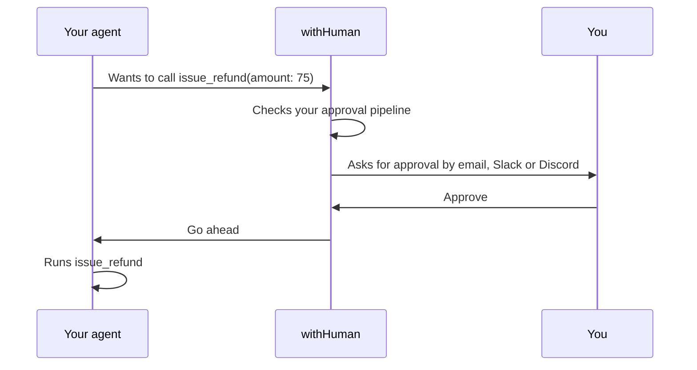

<p align="center">
  <picture>
    <source media="(prefers-color-scheme: dark)" srcset=".github/readme/logo-dark.svg">
    
  </picture>
</p>

<p align="center"><strong>The approval layer for AI agents.</strong><br>
Let your agents work on their own, and have them ask you before anything risky.</p>

<p align="center">
  <a href="https://github.com/withHumanAI/withHuman/tags"></a>
  <a href="https://github.com/withHumanAI/withHuman/actions/workflows/release.yml"></a>
  <a href="https://quay.io/repository/withhuman/bundle"></a>
  <a href="go.mod"></a>
  <a href="LICENSE"></a>
  <a href="https://agentapprovalprotocol.io"></a>
  <a href="https://x.com/withHumanAI"></a>
</p>

<p align="center">
  <a href="https://withhuman.ai">Website</a> ·
  <a href="https://withhuman.ai/docs">Docs</a> ·
  <a href="#quickstart">Quickstart</a> ·
  <a href="https://withhuman.ai/docs/concepts/how-withhuman-works">How it works</a> ·
  <a href="CONTRIBUTING.md">Contributing</a>
</p>

---

AI agents are good at getting work done, until one issues a refund, merges
a pull request or deletes a database you didn't expect. withHuman checks
every tool call your agents make. Your rules approve the safe ones, block
the dangerous ones, and send the rest to a person. The agent waits for the
answer, then carries on.

<p align="center">
  <picture>
    <source media="(prefers-color-scheme: dark)" srcset=".github/readme/request-dark.png">
    
  </picture>
</p>

## What you can do

- **Keep the agents you already use.** Connect Claude Code, Codex,
  OpenClaw, Pi, Hermes or DeepSeek with one command. Their tools don't
  change: withHuman sees each call before it runs.
- **Decide what needs a person.** Approval pipelines approve, deny or ask
  someone based on the tool and its arguments, such as "approve refunds up
  to $20, ask payments above that".
- **Reach the right people.** Escalation paths choose who is asked and
  when, by team, level and working hours. People are notified by email,
  Slack or Discord.
- **Decide with the full picture.** Reviewers see the exact arguments, the
  agent's explanation and why the request needs them, then approve or deny
  with a note the agent reads.
- **Run it yourself.** One binary with its database and workflow engine
  built in. Start it with Docker or from source, with no other services.
- **Build on an open protocol.** Agents talk to withHuman through the
  [Agent Approval Protocol](https://agentapprovalprotocol.io), an open
  specification.

## How it works



Calls your rules approve go straight through, and calls they deny never
run. Read [how withHuman works](https://withhuman.ai/docs/concepts/how-withhuman-works)
for agents, approval pipelines and escalation paths.

## Quickstart

You need [Docker](https://docs.docker.com/get-docker/).

**1. Start withHuman**

```sh
docker run -d --name withhuman -p 8080:8080 -v withhuman-data:/data \
  quay.io/withhuman/bundle:latest
```

**2. Create your account**

Print the one-time setup secret:

```sh
docker exec withhuman cat /data/bootstrap-secret
```

Open [http://localhost:8080](http://localhost:8080), choose **First
setup**, and enter the secret.

**3. Connect your agent**

The welcome page walks you through connecting your first agent and choosing
which calls need your approval. It ends with a test call for you to approve.

To connect another machine later, install the CLI there and point it at
your server:

```sh
curl -fsSL https://downloads.withhuman.ai/install.sh | sh
withhuman agent install --url https://approvals.example.com
```

The [quickstart guide](https://withhuman.ai/docs/getting-started/quickstart)
covers each step in detail, and the [CLI guide](deployment/cli/README.md)
covers every command.

<details>
<summary><strong>Run from source instead</strong></summary>

You need Go (the version in [`go.mod`](go.mod)) and Node 25.

```sh
make frontend
go run ./cmd/withhuman
```

State lives in `~/.withhuman` (set `--data-dir` or `WITHHUMAN_DATA_DIR` to
move it), and the setup secret is in `~/.withhuman/bootstrap-secret`. The
first start downloads PostgreSQL (about 32 MB); later starts work offline.

</details>

## Let your coding agent set it up

withHuman publishes [agent skills](skills/) that teach a coding agent how
to connect runtimes and write approval pipelines for you:

```sh
npx skills add https://withhuman.ai
```

## Configuration

Settings are environment variables. [`.env.example`](.env.example) lists
them for `docker run --env-file`. Nothing is required to try withHuman on
your own machine.

<details>
<summary><strong>All settings</strong></summary>

| Variable | Purpose |
|---|---|
| `WITHHUMAN_PUBLIC_ORIGIN` | The exact origin people use to reach the server, such as `https://approvals.example.com`. Default `http://localhost:8080`. |
| `WITHHUMAN_HTTP_ADDRESS` | Listen address. Default `:8080`. |
| `WITHHUMAN_DATA_DIR` | Where all state lives. Default `~/.withhuman`, or `/data` in the image. |
| `WITHHUMAN_BOOTSTRAP_SECRET` | The secret for creating the first owner. Generated into the data directory when unset. |
| `WITHHUMAN_TRUSTED_PROXIES` | CIDRs of reverse proxies whose forwarded headers to trust. |
| `WITHHUMAN_SECRETS_KEY` | Encrypts stored secrets. Required for webhook blocks, Slack and asynchronous agent replies. |
| `WITHHUMAN_SMTP_HOST`, `_PORT`, `_USERNAME`, `_PASSWORD`, `_FROM` | Email delivery for invitations, password resets and notifications. |
| `WITHHUMAN_SLACK_APP_ID`, `_CLIENT_ID`, `_CLIENT_SECRET`, `_SIGNING_SECRET` | Slack notifications. See [deployment/slack](deployment/slack). |
| `WITHHUMAN_DISCORD_CLIENT_ID`, `_CLIENT_SECRET`, `_BOT_TOKEN` | Discord notifications. See [deployment/discord](deployment/discord). |

Generate a secrets key with:

```sh
openssl rand -base64 32 | tr '+/' '-_' | tr -d '='
```

Interactive CLI commands check `downloads.withhuman.ai` for a newer CLI
once a day. Set `WITHHUMAN_NO_UPDATE_CHECK=1` to turn that off.

</details>

## Deploy to a server

<details>
<summary><strong>Checklist before you go beyond your own machine</strong></summary>

1. Put it behind an HTTPS reverse proxy and set `WITHHUMAN_PUBLIC_ORIGIN`
   to that origin.
2. Set `WITHHUMAN_TRUSTED_PROXIES` to your proxy's addresses only.
3. Set `WITHHUMAN_SECRETS_KEY` and keep it safe. Losing it makes stored
   webhook and Slack secrets unreadable.
4. Configure SMTP so invitations and password resets reach people.
5. Back up the whole data directory. It holds the database, the workflow
   state and the setup secret together.

</details>

## Hosted edition

Don't want to run it yourself? [withhuman.ai](https://withhuman.ai) runs
it for you, and adds the audit log, the AI judge block, the MCP gateway,
text message, WhatsApp and phone app notifications, organization API keys,
and single sign-on with directory sync.

## Contributing

Bug reports, ideas and pull requests are welcome. Read
[CONTRIBUTING.md](CONTRIBUTING.md) to get set up, and follow our
[code of conduct](CODE_OF_CONDUCT.md). Report security vulnerabilities
privately as described in [SECURITY.md](SECURITY.md).

<details>
<summary><strong>Development commands and code layout</strong></summary>

```sh
make test        # build the frontend, then run Go tests and vet
make verify      # also validate the OpenAPI contract and deployment files
make frontend    # rebuild the React assets embedded in the binary
make smoke       # run one real approval against a running server
```

`webapp/assets` is generated and not committed, so use the Make targets
rather than plain `go test` or `go build` from a clean checkout. The smoke
test signs in as `owner@example.com` with `local-development-password`
(set `WITHHUMAN_SMOKE_PASSWORD` to change it). The HTTP API contract is
served at `/api/openapi.yaml` and lives in
[`internal/httpapi/openapi.yaml`](internal/httpapi/openapi.yaml).

```text
cmd/                         process composition only
domain/                      provider-neutral identity and approval types
application/                 focused storage and orchestration ports
approvalblock/               serializable CEL block definitions and Go authoring DSL
authn/                       human sessions, agent enrollment and credentials
entitlements/                open plan-gating adapters (unlimited by default)
loggermdc/                   shared logging bootstrap and immutable correlation context
internal/approvalpipeline/   safe block execution contract and compiled CEL runtime
internal/approvals/          use-case validation and long-poll behavior
internal/orchestration/      Temporal client, workflow, and activities
internal/postgres/           canonical product storage and atomic authorization
sealbox/                     AES-GCM sealing for secrets at rest
authz/                       the permission checks every service uses
internal/httpapi/            Gin boundary and embedded frontend
frontend/                    React web application
db/migrations/               application-owned migrations
deployment/temporal/         Temporal-owned migration and namespace setup
```

The server evaluates the active pipeline synchronously, then atomically
commits the request, its state, any automatic decision and a pending-only
workflow-start outbox item. Temporal coordinates human approvals, deadlines
and retries, and is never used for policy evaluation or as the read model:
API reads, the queue stream and long polls read PostgreSQL only. The
architecture rules live in [CLAUDE.md](CLAUDE.md).

</details>

## License

withHuman core is licensed under the [Elastic License 2.0](LICENSE). In
short, you may use, modify and self-host it, but you may not provide it to
others as a hosted or managed service or remove its licensing notices. The
license text has the exact terms. The Agent Approval Protocol
specification and its Go library are licensed separately under the Apache
License 2.0.

withHuman and the withHuman logo are trademarks of Metoro, Inc. The
license covers the code, not the name or logo. Don't use them in a way
that suggests your product or service is withHuman or is endorsed by us.
