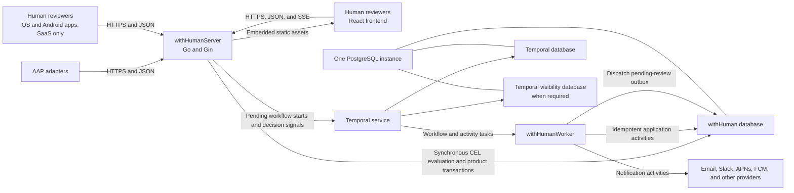
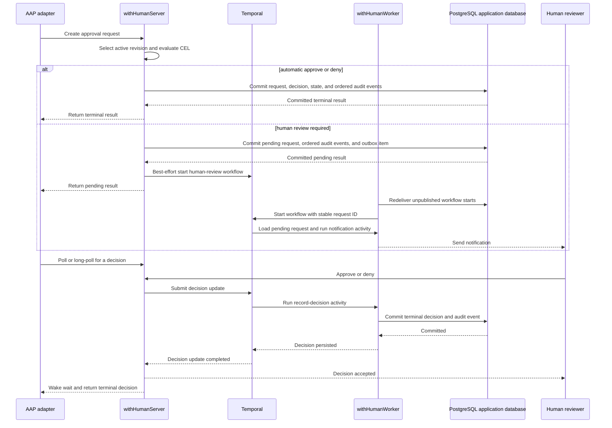

# withHuman AAP provider architecture

Status: draft · Last updated: 2026-08-28

> **Prototype.** Same caveat as
> [00-general-design.md](00-general-design.md): everything here can change
> without migration paths or backwards-compatibility constraints. Optimize for
> the right model.

## Summary

The withHuman AAP provider has five architectural components:

1. **`withHumanServer`**, a Go HTTP server built with Gin. It serves the AAP
   API, the product API, realtime HTTP connections, and the compiled React
   frontend.
2. **The React frontend**, built as static HTML, JavaScript, and CSS and
   embedded into `withHumanServer`. It is not a separate production service.
3. **Temporal**, which durably orchestrates approval deadlines,
   notifications, reminders, and later escalation workflows.
4. **`withHumanWorker`**, a Go binary that runs Temporal workflow and activity
   implementations, including activities that persist product state and send
   notifications.
5. **PostgreSQL**, the shared database instance used for application and
   Temporal persistence.

These are deployed as four runtime units because the React frontend is
compiled into `withHumanServer`. PostgreSQL is the persistence layer for both
withHuman and Temporal. They use the same PostgreSQL instance but separate
logical databases, credentials, and migration ownership. PostgreSQL
application data is the durable, queryable product record. Temporal is the
authoritative coordinator only after a request requires asynchronous human or
external work.

The hosted SaaS also has native iOS and Android reviewer applications. They
receive push notifications, show approval requests, and let an authenticated
reviewer approve or deny from a mobile device. The mobile applications are
closed source and available only with the SaaS product. They are clients of
`withHumanServer`, not additional components in a self-hosted provider
deployment.

This document describes those components and their boundaries. The AAP
protocol and adapters are covered by
[00-general-design.md](00-general-design.md) and
[01-aap-adapters.md](01-aap-adapters.md). Authentication, authorization, and
identity internals are covered by
[02-auth-architecture.md](02-auth-architecture.md).

## Goals

- Produce a small, self-hostable deployment with one public server binary and
  one background worker binary.
- Serve the product frontend and APIs from the same origin.
- Expose one product API and authorization boundary to the web, iOS, and
  Android reviewer clients.
- Keep committed approval requests and decisions queryable from PostgreSQL
  without reading Temporal workflow histories.
- Evaluate deterministic local policy synchronously in the HTTP hot path and
  return automatic decisions without creating Temporal workflows.
- Route pending human approval through Temporal so one durable workflow
  serializes decisions, deadlines, and notifications.
- Use Temporal for long-running coordination, timers, and retries instead of
  implementing a job system in the HTTP server.
- Allow HTTP servers and workers to scale independently.
- Use the same component boundaries for self-hosted and hosted deployments.
- Fail closed when the provider cannot return a valid approval decision.

## Non-goals

- Defining AAP request and response fields.
- Defining database tables or identifiers.
- Defining roles, permissions, sessions, or identity-provider integrations.
- Defining the detailed notification content for each channel.
- Hosting or executing agent tool calls. AAP carries decisions only.
- Defining the internals of the hosted MCP chokepoint gateway. It is a
  separate process with its own data-path and credential boundary, and it
  reaches this architecture only as an HTTP client (see doc 01).

## System context

Only `withHumanServer` is exposed to browsers, mobile applications, and AAP
clients. PostgreSQL, Temporal, and `withHumanWorker` remain on the private
application network. Notification services are outbound integrations, not
part of the core deployment.

## Component responsibilities

### `withHumanServer`

`withHumanServer` is the public entry point for the provider. It is a
stateless Go process apart from its active HTTP connections.

It owns:

- AAP endpoints for creating requests, reading decisions, and long-polling.
- Product endpoints for the reviewer queue, decisions, audit history, and
  administration, shared by the web and native mobile clients.
- Agent administration, runtime-instance enrollment, and instance credential
  issuance and revocation.
- Mobile device registration and push-notification preferences in the hosted
  SaaS deployment.
- Authentication and authorization enforcement at the HTTP boundary.
- Server-sent events for live queue and request updates.
- Validation of incoming requests, synchronous deterministic policy
  evaluation, and atomic automatic decisions.
- Product reads and synchronous transactions for configuration and request
  initialization.
- Immediate best-effort dispatch of pending human-review workflows. The
  PostgreSQL outbox remains the durable handoff.
- Serving the embedded React build and its static assets.
- Liveness, readiness, and metrics endpoints.

It does not own:

- Notification scheduling or retries.
- Long-running timers.
- Temporal workflow implementation.
- Agent tool execution.
- Temporal persistence tables.

Server replicas share no required in-memory state. Long polls and server-sent
event connections may terminate when a replica is replaced and clients must
reconnect. Sticky sessions are not required.

### React frontend

The product UI is a React single-page application built with TypeScript and a
static bundler such as Vite. A production build emits hashed JavaScript and CSS
assets plus the application HTML shell. The Go build embeds those outputs into
`withHumanServer` using `go:embed`.

The production deployment therefore has no Node.js runtime and no separate
frontend server. The browser calls the Gin APIs on the same origin, which
simplifies cookies, cross-origin policy, local self-hosting, and deployment.

The server uses these asset rules:

- Hashed assets receive long-lived immutable cache headers.
- The HTML shell is not cached immutably, so a deployment can point clients at
  the current asset hashes.
- Unknown frontend routes fall back to the HTML shell.
- API, authentication, health, and metrics routes never use the frontend
  fallback.
- Deployment-specific settings are loaded from a same-origin runtime endpoint
  rather than compiled into the frontend bundle.

The marketing website remains a separate Next.js application. It has public
content and SEO requirements that the authenticated product frontend does not.

### Native mobile applications

withHuman provides native iOS and Android applications for SaaS reviewers.
They use the same product API, canonical identity, organization authorization,
and Temporal-backed decision path as the web frontend.

A mobile push notification is only a prompt that a request is waiting. It does
not carry approval authority and does not itself record a decision. Opening or
acting on the notification causes the application to authenticate the human,
load the current request from `withHumanServer`, and submit approve or deny
through the normal product endpoint. The server re-evaluates authorization and
routes the decision into the request's Temporal workflow.

Push delivery is performed by `withHumanWorker` notification activities using
Apple Push Notification service for iOS and Firebase Cloud Messaging for
Android. Device tokens and notification preferences are application data in
PostgreSQL. Push-provider credentials are runtime secrets in the hosted
deployment.

The native applications are closed source and distributed only as part of the
hosted SaaS product. They are not included in the open-source repository or
self-hosted distribution. The provider's HTTP APIs and web reviewer UI remain
part of the open-source product core.

### PostgreSQL

One PostgreSQL instance backs both the application and Temporal. Within that
instance, each system has an isolated logical database and database user:

- The **withHuman application database** contains product state, including
  organizations, agents, agent instances, request approval pipelines and
  blocks, approval requests, decisions, instance credentials, audit events,
  and other application data.
- The **Temporal database** contains workflow histories, timers, task queues,
  and other Temporal-owned persistence.
- A separate **Temporal visibility database** is used when required by the
  selected Temporal deployment configuration.

The separation is a hard ownership boundary even though the databases share a
PostgreSQL process:

- withHuman code never reads or writes Temporal tables.
- Temporal exclusively owns its schema and migrations.
- Application migrations and Temporal migrations run independently.
- withHuman and Temporal use separate credentials and connection-pool limits.
- The deployment can move Temporal persistence to another PostgreSQL instance
  later without changing application behavior.

Sharing an instance reduces operational overhead for the prototype. It also
creates a shared failure and resource-contention boundary. Capacity planning,
monitoring, backup, and restore procedures must account for both workloads.

### Temporal

Temporal is a separately running service. `withHumanServer` and
`withHumanWorker` communicate with it through the Temporal API. Neither process
communicates with Temporal by accessing its database directly.

Normally, one workflow execution coordinates the asynchronous lifecycle of
one approval request. That workflow may:

- Schedule the initial notifications.
- Retry transient notification failures.
- Wait durably for a human decision.
- Send reminders after configured intervals.
- Add escalation or reassignment behavior later.
- Reach the request deadline and initiate expiration.
- Stop future notifications once a terminal decision exists.

Temporal does not become the source from which clients read approval state.
Adapters and browsers always read application state through
`withHumanServer`. This keeps requests, terminal decisions, attribution, and
the audit trail available as ordinary product data. Pending human-review
commands enter through Temporal so the workflow can order
decisions, deadlines, and notification behavior consistently. Automatic CEL
decisions never create a workflow.

### `withHumanWorker`

`withHumanWorker` is a Go process that connects to Temporal task queues and
registers the provider's workflow and activity implementations.

It owns:

- Deterministic Temporal workflow code.
- A dispatcher that delivers committed pending-review outbox items to
  Temporal using idempotent workflow IDs.
- Activities that load pending approvals and persist human or system terminal
  decisions and audit events in PostgreSQL.
- Activities that send notifications through external providers.
- Activities that apply time-based application transitions, such as
  expiration, through idempotent application transactions.
- Worker health and orchestration metrics.

Workflow code performs no direct network or database I/O. External I/O occurs
in activities. Worker replicas are otherwise stateless and may be added or
removed independently of HTTP server replicas.

## Data ownership and consistency

The central rules are:

> PostgreSQL owns synchronous request initialization and every durable product
> and audit record. Temporal coordinates only asynchronous pending lifecycles.

The server evaluates deterministic local blocks before starting orchestration.
It commits the request, ordered evaluation evidence, state, optional automatic
decision, and a pending-only outbox item in one transaction. An automatic
result returns immediately. A pending result is durably handed to Temporal,
which orders later human decisions against deadlines and persists those
transitions through activities.

Adapters and browsers never query workflow state directly. They read the
PostgreSQL product record through `withHumanServer`. Temporal workflow history
is operational state used to resume orchestration, not the product's query
API.

### Synchronous initialization and durable handoff

`withHumanServer` selects and evaluates CEL pipelines in process. This hot path
does not call Temporal. The application transaction inserts a human-review
outbox item only when the resulting request is pending. Automatic requests do
not produce an outbox item.

The server attempts to start a pending workflow immediately, and workers
periodically redeliver unpublished outbox items. A crash after the product
commit therefore cannot orphan a pending request. Stable workflow IDs make
duplicate delivery harmless. Human decisions use signal-with-start so a
decision racing the dispatcher still creates or reaches the same workflow.

Database writes and workflow starts use stable deduplication keys so an HTTP
retry reattaches to the existing request and workflow.

### Creation acknowledgement

The create-request endpoint returns after the PostgreSQL initialization
transaction commits. An automatic response is terminal. A human response is
pending and its outbox record guarantees eventual workflow start even if
Temporal is temporarily unavailable.

### Terminal-state ordering

A human decision and the request deadline may become ready at nearly the same
time. Both are handled inside the same workflow, which chooses one terminal
transition and then persists it through an activity. The database transaction
also guards against changing an existing terminal record, providing
idempotency for activity retries.

## Primary request lifecycle

The human UI may observe the new request directly from PostgreSQL as soon as
the initialization transaction commits. Temporal is not on the policy,
automatic-decision, or read path for the queue, request detail, audit log,
polling, or long-polling.

## Deadline lifecycle

If no reviewer decides before the deadline:

1. The Temporal workflow's durable timer fires.
2. The workflow chooses expiration as its terminal transition.
3. A worker activity records the expired state and audit event in the
   application database.
4. `withHumanServer` returns the expired state to waiting adapters.
5. Any duplicate timer, signal, or activity retry observes the existing
   terminal state and becomes a no-op.

The deadline is absolute application data, not merely a relative Temporal
timer. If orchestration is unavailable past the deadline, the recovered
workflow can determine that the deadline has already elapsed and expire the
request immediately.

## Availability and failure behavior

### `withHumanServer` unavailable

- Browsers and adapters cannot access the provider.
- Adapters fail closed and do not execute gated calls.
- Existing Temporal workflows and workers may continue timers and notification
  processing.

### `withHumanWorker` unavailable

- Existing product records remain readable through the server.
- Temporal durably retains workflow and activity tasks until workers recover.
- New requests still evaluate local policy and commit automatic or pending
  results. Pending outbox items remain unpublished until a worker recovers.
- Human decisions and expiration cannot complete their PostgreSQL activity
  while no worker is available.
- Notifications, reminders, and expiration processing pause.

### Temporal unavailable

- Existing product records, the reviewer queue, and adapter polling remain
  readable from PostgreSQL.
- New requests still evaluate local policy. Automatic decisions commit and
  return normally. Requests requiring a human commit as pending with an outbox
  item for later workflow delivery.
- Human decisions cannot complete until Temporal recovers, although a racing
  decision submission safely uses the request's stable workflow ID.
- Notifications, reminders, and expiration processing pause until Temporal
  recovers.
- Server readiness reports Temporal as degraded while keeping the synchronous
  policy path available. Adapters fail closed if no terminal decision is
  available.

### PostgreSQL unavailable

- The provider cannot create, read, or decide requests.
- Because Temporal uses the same PostgreSQL instance, orchestration persistence
  is also unavailable.
- Servers report not ready, adapters fail closed, and workers resume from
  durable state after PostgreSQL recovers.

This shared PostgreSQL failure domain is an accepted prototype tradeoff. The
logical database boundary preserves the option to separate the workloads
later.

### Notification provider unavailable

- Temporal activities retry according to channel-specific policy.
- The request remains visible through the product API and web queue even when
  push delivery fails.
- A notification failure never changes an approval decision or permits the
  agent action.

## Deployment topology

There is additionally a single-binary topology that compiles these same
components into one process, with embedded PostgreSQL as a managed child
process, for local use, evaluation, and hermetic tests. It is specified in
[04-single-binary.md](04-single-binary.md).

### Minimum self-hosted deployment

The self-hosted deployment is the single binary
([04-single-binary.md](04-single-binary.md)): one process carrying
`withHumanServer`, `withHumanWorker`, an embedded Temporal server, and an
embedded PostgreSQL, persisting everything under one data directory.
External notification integrations are optional. The closed-source iOS and
Android applications and the SaaS mobile-push service are not included in
the self-hosted deployment. The split topology below, its Compose stack,
and its Kubernetes chart are the hosted edition's.

### Hosted or larger deployment

The same architecture scales horizontally:

- Multiple `withHumanServer` replicas sit behind an HTTPS load balancer.
- Multiple `withHumanWorker` replicas consume shared Temporal task queues.
- Temporal may run as a production cluster rather than a single development
  service.
- PostgreSQL may use managed high availability and read replicas where useful.

Server and worker replica counts are independent. A burst of browser or AAP
traffic should not require more workflow workers, and a notification backlog
should not require more HTTP servers.

## Configuration and secrets

Both Go binaries use the same configuration model for environment-specific
settings. Secrets are supplied at runtime and are never embedded into the
React build.

At minimum, the deployment supplies:

- Application database connectivity.
- Temporal service connectivity and task-queue configuration.
- Browser session and agent enrollment or credential secrets.
- Notification-provider credentials.
- Apple Push Notification service and Firebase Cloud Messaging credentials in
  the hosted SaaS deployment.
- Public origin and trusted-proxy configuration.

Production deployments should support an external secret manager or KMS for
encryption keys and stored provider credentials. The frontend receives only
public runtime configuration.

## Migrations and startup

Application migrations and Temporal persistence migrations are distinct
deployment steps. Normal server and worker replicas do not race to apply
migrations during startup.

The startup order is:

1. PostgreSQL is available.
2. Temporal-owned migrations are applied and the Temporal service becomes
   ready.
3. withHuman application migrations are applied.
4. `withHumanWorker` and `withHumanServer` start.

The server may serve liveness before all dependencies are available, but it
does not report readiness until it can safely serve application traffic. This
includes compiling every active request approval pipeline under the process's
current runtime fingerprint.

## Observability

The deployment needs visibility across the HTTP, database, Temporal, and
notification boundaries. The initial operational signals are:

- HTTP request rate, errors, and latency.
- Approval creation-to-decision latency.
- PostgreSQL availability, pool saturation, and transaction latency.
- Temporal start and update failures, task-queue latency, workflow failures,
  and activity retries.
- Notification attempts and failures by channel.
- Active and expired approval counts.

Logs and traces carry the approval request and workflow correlation context so
one lifecycle can be followed across server and worker processes. Audit events
remain product records and are not replaced by operational logs.

## Deferred components

The initial architecture deliberately does not require Redis, Kafka, a
separate static host, or a Node.js production server. PostgreSQL, Temporal, and
HTTP streaming cover the known requirements.

The hosted MCP chokepoint gateway stays outside this topology by design. It
is a separate Go process (`withhuman-gateway`) because it proxies tool
execution, handles downstream credentials, and has a materially different
availability and security boundary from the decision-only provider API. It
holds no database connection and no durable state: it reaches
`withHumanServer` over HTTPS like any other client, on the AAP surface for
decisions and on a machine configuration surface for each organization's
server registry and downstream credentials. One gateway serves every
organization of the provider, authenticated by the deployment's gateway
token and scoped per call by the organization the calling host's
credential resolves to. Because its MCP sessions live in memory, it
runs as a single replica for now, and an outage of it costs only the
chokepoint tools rather than the queue.

## Open questions

- Which Temporal deployment shape is the default for local development and
  for the documented self-hosted production setup?
- Which notification channels besides SaaS mobile push ship in the first
  provider release?
- Does the first hosted deployment need a separate PostgreSQL instance for
  Temporal sooner than the self-hosted deployment does?
